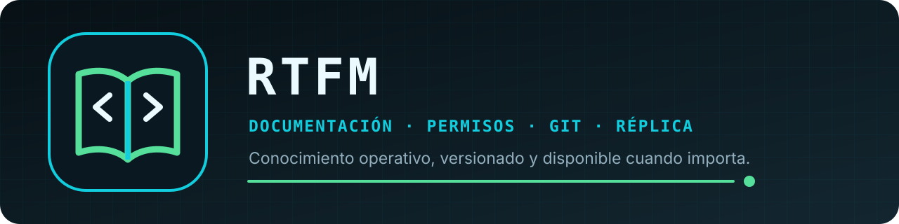

<p align="center">
  
</p>

<p align="center">
  
  
  <a href="LICENSE"></a>
</p>

# RTFM

RTFM es una aplicación autohospedada para organizar documentación técnica,
procedimientos, diagramas y conocimiento operativo. Incluye portal web, API, permisos,
historial, auditoría, exportación a PDF y réplica entre nodos.

Se ejecuta en un único contenedor para servidores Linux `amd64` y `arm64`, incluidos
equipos Raspberry Pi con sistema operativo de 64 bits.

> RTFM se distribuye actualmente mediante el canal `dev`. Puede incluir cambios todavía
> no considerados estables.

## Funciones principales

- Bibliotecas, categorías y documentos Markdown.
- Editor con imágenes y diagramas.
- Búsqueda, favoritos y orden personalizado.
- Exportación de documentos a PDF desde el navegador.
- Usuarios con roles globales y permisos por biblioteca.
- Segundo factor TOTP y clientes API independientes.
- Auditoría, historial Git, archivado y recuperación.
- Réplica entre nodos con un único escritor activo.

## Instalación con Docker

```bash
sudo mkdir -p /srv/rtfm
sudo chown 10001:10001 /srv/rtfm
sudo chmod 700 /srv/rtfm

sudo docker run -d \
  --name rtfm \
  --restart unless-stopped \
  --init \
  --network host \
  --read-only \
  --cap-drop ALL \
  --security-opt no-new-privileges \
  --pids-limit 256 \
  --tmpfs /tmp:rw,nosuid,noexec,size=128m,mode=1777 \
  -e PORT=7400 \
  -v /srv/rtfm:/data \
  ghcr.io/ezr43l/rtfm-s:dev
```

Abre `http://SERVIDOR:7400` y completa el asistente de configuración.

También puedes utilizar [Docker Compose](compose.yaml). Conserva siempre el volumen
`/data`: contiene documentos, cuentas, configuración, historial y credenciales internas.

## Modos de funcionamiento

- **Servidor único:** elige `active`; no necesita Keepalived ni otros nodos.
- **Alta disponibilidad:** elige `auto`, conecta Keepalived y declara los miembros del
  grupo. Sólo el nodo que posee la dirección flotante acepta escrituras.
- **Pasivo o desconocido:** bloquea las escrituras hasta que la autoridad esté clara.

Si RTFM no puede determinar con seguridad qué nodo es activo, protege el contenido
rechazando las modificaciones.

## Incorporar nodos

Configura primero el nodo que iniciará el grupo. El asistente genera un código de
incorporación con los secretos compartidos y la identidad necesaria para la réplica.

Al instalar otro nodo, pega ese código en su asistente. Las cuentas, permisos y documentos
llegarán desde el nodo activo. El token local de Keepalived se configura por separado en
cada servidor.

El código de incorporación es una credencial temporal: consérvalo únicamente mientras
añades los nodos.

## Datos y copias de seguridad

El volumen `/data` contiene:

- documentos, imágenes, metadatos y elementos eliminados;
- cuentas, permisos y auditoría;
- historial Git;
- configuración, secretos y certificados privados.

Una copia de seguridad debe incluir el volumen completo. Restaurar sólo los documentos
deja fuera la identidad del nodo y las credenciales del grupo.

## Acceso y API

La primera cuenta recibe control total. Los demás usuarios pueden tener los roles
`reader`, `operator` o `full_control`, además de permisos específicos por biblioteca.

La API principal utiliza `/api/v1`. Estado y configuración inicial:

```text
GET  /api/v1/setup
POST /api/v1/setup
GET  /api/v1/public-status
GET  /api/health
GET  /api/version
```

Consulta [docs/API-CONTRACT.md](docs/API-CONTRACT.md) para conocer el contrato completo.

## Seguridad

No expongas RTFM directamente en Internet sin HTTPS y una revisión del despliegue.
Protege el volumen persistente y los códigos de incorporación. Utiliza una credencial
diferente para cada cliente API.

Más información:

- [Arquitectura](docs/ARCHITECTURE.md)
- [Modelo de seguridad](docs/SECURITY-MODEL.md)
- [Contrato de réplica](docs/REPLICATION-CONTRACT.md)
- [Modelo de datos](docs/DATA-MODEL.md)

## Soporte

El soporte se presta en la comunidad de Discord de Unraides:

https://discord.gg/8MAT6ZGJTW

No compartas contraseñas, tokens, códigos de incorporación ni documentación privada.

## Licencia

Código y documentación: [Apache License 2.0](LICENSE).
Los componentes de terceros se detallan en
[THIRD_PARTY_NOTICES.md](THIRD_PARTY_NOTICES.md).

